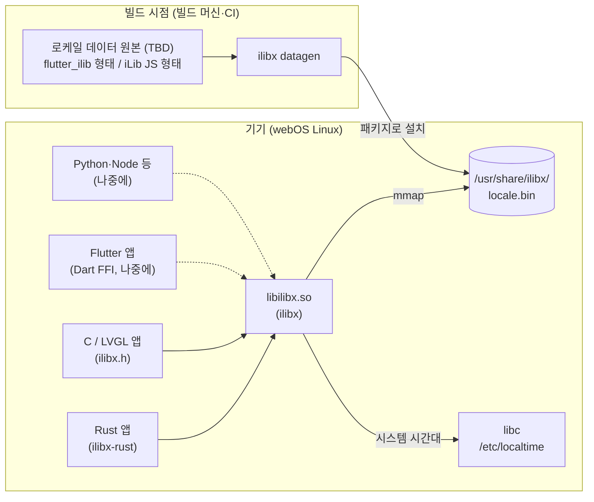
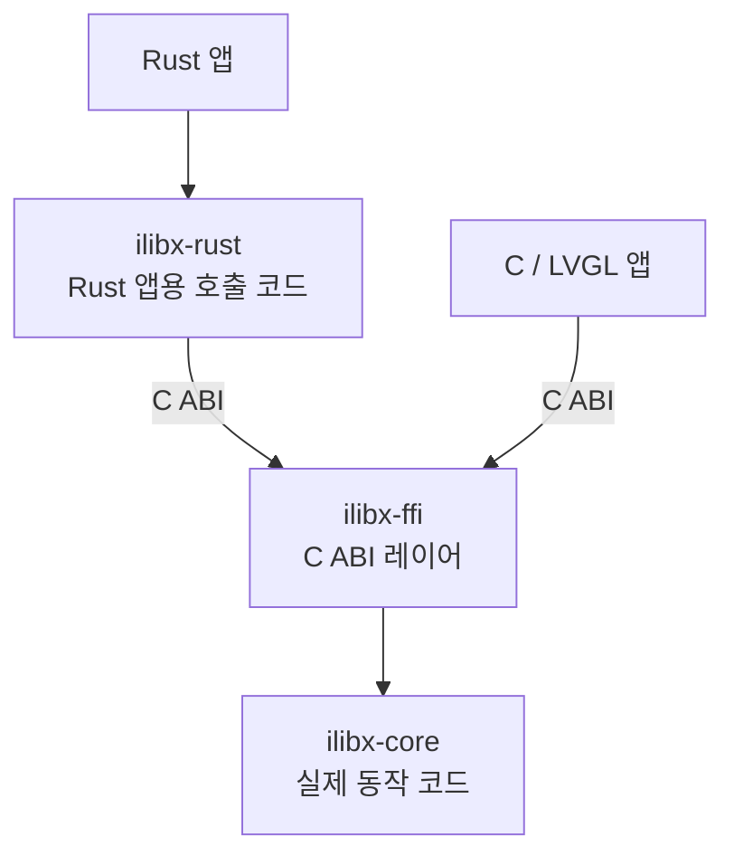
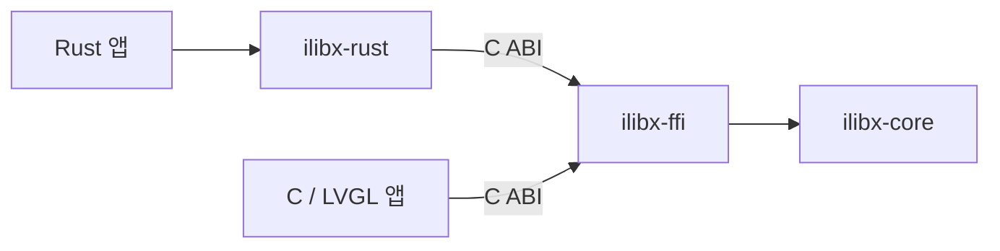

# (LLD) ilibx

> **영어판**: [LLD_ilibx.md](LLD_ilibx.md). 이 한국어판이 작성 원본이며, 영어판은 이 문서를 번역해 만든다. 내용을 고칠 때는 이 문서를 먼저 고친다.

| 날짜 | 변경 내용 |
|---|---|
| 2026-11-25 | 초안. 개요(§1~§4)와 구조(§5)를 기존 설계 문서에서 옮겨 채움. 측정값·검증·미정 항목은 TBD. 로케일 데이터 원본 형태(flutter_ilib / iLib JS)는 미정으로 표시 |
| 2026-11-25 | 아직 구현하지 않은 부분(§5.1.2, §5.2.2~§5.2.8, §5.4 사용 예, §5.5)을 비우고 TBD로 둠. 구현하면서 채워 나감 |
| 2026-11-25 | §5를 정해진 컨셉(ilibx-core, ilibx-ffi, ilibx-rust 세 패키지의 존재와 호출 관계)까지만 남기고 나머지(§5.1.3, §5.3, §5.4 포함)를 TBD로 둠 |

> **이 초안에 대해**: [LLD_flutter_ilib](https://github.com/iLib-js/flutter_ilib/blob/develop/doc/design/LLD_flutter_ilib.md)과 같은 형식을 따른다. ilibx는 아직 구현 전이라 측정값, 테스트 링크, 일부 설계 항목은 **TBD**로 둔다.
>
> **로케일 데이터 처리 방식은 미정이다(TBD, [§6 #17](#open-issues))**. 원본을 flutter_ilib 형태(로케일별 파일 하나에 모든 데이터 종류)로 쓸지, iLib JS 형태(로케일 디렉터리 아래 데이터 종류별 파일)로 쓸지 검토와 추가 조사가 필요하다. 데이터 원본, 섹션 선택, 조회 규칙, 생성 단계에 관한 서술은 flutter_ilib 형태를 가정한 안이며, 해당 부분에 따로 표시했다.

## 1. 문서 설명 (Document Descriptions)

### 1.1 문서의 목적

ilibx는 Native 앱(Rust, C/LVGL 등)용 i18n 라이브러리다. iLib 계열 라이브러리(iLib JS, flutter_ilib)가 제공하는 날짜·숫자·시간대 등의 로케일별 결과를 Native 앱에서도 같은 사양으로 얻게 한다. flutter_ilib v2.0(순수 Dart)의 로직을 Rust로 옮기고, 공용 라이브러리 하나와 데이터 파일 하나를 모든 앱이 공유한다. 기본 로케일 데이터 위에 플랫폼이나 제품에 맞춘 커스텀 데이터를 빌드 때 합칠 수 있는 구조로 한다.

이 문서는 ilibx의 구현·검증·리뷰에서 공통으로 참조하는 저수준 설계를 정리한다.

### 1.2 문서의 범위

대상: ilibx 초기 버전(v0.1.0 예정). 로케일 데이터 원본의 형태(flutter_ilib `assets/locale/` / iLib JS `js/data/locale/`)는 TBD다(§6 #17). 기존 검토는 flutter_ilib `assets/locale/`(2.0.0 `de16084`)을 기준으로 했다.

**포함**

- 공개 인터페이스: C ABI(`libilibx.so`, `ilibx.h`)와 Rust 앱용 호출 코드(ilibx-rust)
- 코어 로직(ilibx-core): 포맷, 달력, 시간대, 복수형, 로케일 데이터 조회
- 데이터 파일 `locale.bin`의 형식과 생성 도구(datagen), 덤프 도구(ilibx-dump)
- 런타임 동작(mmap 로딩, 로케일 체인 조회)
- 저장소·패키지 구조, 빌드·배포 형태, 테스트·CI 구조

**제외**

- iLib JS와 flutter_ilib의 내부 구현 (결과 일치의 기준으로만 참조)
- CLDR과 ilib-assemble의 내부 동작
- ilibx를 쓰는 개별 앱, LVGL 자체, webOS 플랫폼과 Yocto 빌드 시스템
- 번역 문자열(ResBundle) 처리. webOS에서는 libwebosi18n이 맡는다

### 1.3 문서의 구성

| 장 | 제목 | 내용 |
|---|---|---|
| 1 | 문서 설명 | 목적, 범위, 구성, 용어 |
| 2 | 프로젝트 개요 | 목표 조건과 구성 |
| 3 | 아키텍처 동인 | 제약 사항, 기능 요구사항, 품질 속성 |
| 4 | 시스템 컨텍스트 | 시스템 경계와 외부 엔티티 |
| 5 | 아키텍처 설계 | 정적(모듈), 동적(C&C), 물리(배치) 관점, 인터페이스와 데이터 형식 |
| 6 | 미결 사항 | 정하지 않은 항목 |
| 7 | 참고 자료 | 참고 문서 |

flutter_ilib LLD 구성에 §5.4(인터페이스 명세), §5.5(데이터 형식), §6(미결 사항)을 더했다. ilibx는 C ABI가 앱과의 계약이고 데이터 파일 형식을 직접 정의하기 때문이다. flutter_ilib LLD의 FMEA 리뷰와 제품군 고려 사항 장은 두지 않는다.

### 1.4 용어와 정의

| 용어 | 설명 |
|---|---|
| iLib | webOS의 JS i18n 라이브러리. CLDR 데이터를 가공한 로케일 데이터와 포맷 로직을 가진다 |
| flutter_ilib | iLib을 Dart로 옮긴 Flutter용 i18n 패키지. ilibx의 결과 일치 기준 |
| CLDR | Unicode Common Locale Data Repository. iLib 로케일 데이터의 원천 |
| BCP-47 | 로케일 태그 표준 (예: `ko-KR`, `zh-Hant-TW`) |
| C ABI | C 언어 방식의 함수 호출 규약. 거의 모든 언어가 이 방식으로 다른 라이브러리를 부를 수 있어 공용 라이브러리의 입구로 쓴다 |
| crate / Cargo 패키지 | Rust 빌드 도구(Cargo)가 한 번에 빌드하는 코드 묶음 |
| cdylib | C ABI로 공개되는 Rust 공유 라이브러리 형태. `libilibx.so`가 이 형태다 |
| soname | 공유 라이브러리의 ABI 버전이 붙은 이름 (`libilibx.so.1`) |
| `no_std` | Rust 표준 라이브러리 중 OS가 필요한 부분(파일, 시간, 스레드 등)을 쓰지 않는다는 선언 |
| alloc | `no_std`에서도 쓸 수 있는 힙 할당 기능(`String`, `Vec` 등) |
| mmap | 파일을 메모리 주소 공간에 매핑하는 OS 기능. 같은 파일을 매핑한 프로세스끼리 물리 페이지를 공유한다 |
| `locale.bin` | 로케일 JSON을 빌드 때 변환한 바이너리 데이터 파일. 기기에 한 벌 |
| 문서 (document) | `locale.bin` 안에서 원본 JSON 파일 하나에 해당하는 값 트리 (`root`, `ko`, `und-KR` 등) |
| 로케일 체인 | 한 로케일의 데이터를 찾을 때 거치는 문서 목록 (root → lang → … → lang-script-region) |
| 값 참조 | `locale.bin`에서 값 하나를 가리키는 32비트 정수 (하위 3비트 종류 + 29비트 값·위치) |
| 제외 목록 | 생성기가 `locale.bin`에서 뺄 데이터 섹션 목록. 옵션이며, 기본은 모든 섹션을 넣는다 |
| PSS | Proportional Set Size. 공유 메모리를 공유 프로세스 수로 나눠 계산한 메모리 사용량 |

## 2. 프로젝트 개요 (Project Overview)

ilibx는 다음 여섯 조건을 모두 만족하는 Native i18n 라이브러리를 목표로 한다.

1. 확장성: Rust, LVGL 등 새 Native 플랫폼에 쉽게 대응. OS 없는 MCU 가능성도 고려
2. 커스텀 데이터: 기본 로케일 데이터 위에 플랫폼이나 제품에 맞춘 커스텀 데이터를 빌드 때 합칠 수 있음
3. 공유: 기기에 라이브러리와 데이터를 한 벌만 두고 모든 앱이 공유
4. 메모리: 사용량이 적고 관리가 안전함
5. ICU 의존 0: ICU4C, ICU4X 계열 crate, ICU 바인딩 모두 쓰지 않음
6. 단일 버전: 모든 앱이 같은 버전의 라이브러리와 데이터를 씀

이 조건에서 나온 구성은 **공용 `.so` 하나 + C ABI + 공용 데이터 파일 한 벌 + 빌드 때 커스텀을 합친 데이터**이고, 구현 언어는 Rust다(11-19 결정).

## 3. 아키텍처 동인 (Architectural Drivers)

### 3.1 제약 사항

#### 3.1.1 비즈니스 제약

**[표 3-1]** 비즈니스 제약

| ID | 제약 | 설명 |
|---|---|---|
| BC01 | 오픈소스 라이선스 (Apache-2.0) | 저장소는 Apache License 2.0으로 배포한다. 기여와 재배포는 라이선스를 따른다 |
| BC02 | iLib·flutter_ilib과 결과 일치 | 같은 로케일·같은 입력에 iLib·flutter_ilib과 같은 결과를 낸다. 정확도보다 일치가 우선이다(예: 과거 날짜 서머타임도 iLib과 같게). 판단 기준은 flutter_ilib 테스트 기대값(21,527건). 기대값은 데이터 원본 형태(§6 #17)와 관계없이 고정하며, 어느 형태를 고르든 이 기대값을 통과해야 한다 |
| BC03 | 지원 로케일 | flutter_ilib과 같은 로케일을 지원한다. 데이터 파일 252개. 로케일 목록 확정 TBD |
| BC04 | 업스트림 버전 정렬 | 로직은 flutter_ilib v2.0(iLib JS v15.0.0, CLDR 48.2 기준)에서 옮긴다. 데이터 원본(flutter_ilib `assets/locale/` / iLib JS `js/data/locale/`)은 TBD(§6 #17). 로직과 데이터는 함께 갱신한다 |

\*BC: Business Constraint

#### 3.1.2 기술 제약

**[표 3-2]** 기술 제약

| ID | 제약 | 설명 |
|---|---|---|
| TC01 | Rust 구현, ICU 의존 0 | 주 언어는 Rust. ICU4C, ICU4X 계열 crate(zerovec, yoke 등 범용 유틸리티 포함), ICU 바인딩을 빌드·링크·데이터 어디에도 쓰지 않는다. cargo-deny와 `readelf`로 검사 |
| TC02 | C ABI로 공개 | 공개 인터페이스는 C ABI 하나다. Rust 앱도 ilibx-rust를 거쳐 C ABI를 부른다 |
| TC03 | 공유 라이브러리 + 공용 데이터 한 벌 | `libilibx.so`(cdylib)와 `/usr/share/ilibx/locale.bin`을 기기에 한 벌씩 둔다. 둘은 같은 릴리스·같은 패키지로 배포한다 |
| TC04 | 단일 버전 | 앱이 코어 로직을 정적으로 포함하지 않는다. ilibx-rust는 ilibx-core·ilibx-ffi를 의존하지 않는다 |
| TC05 | 코어는 `no_std` + alloc | ilibx-core는 OS 기능을 쓰지 않는다. 데이터는 `&[u8]`로만 받고, 파일·mmap·시간 조회는 입구 패키지가 맡는다 |
| TC06 | 최소 Rust 버전 | webOS Yocto의 rustc 버전에 맞춘다. 2026-11-27 기준 webOS의 rustc는 1.75로 보인다(확인 필요). 이에 따라 최소 지원 버전(`rust-version`)은 1.75, edition은 2021로 둔다(edition 2024는 rustc 1.85 이상 필요). 1.75 이후에 안정화된 기능은 쓰지 않으며, CI에서 1.75로 빌드해 검사한다 |
| TC07 | 대상 플랫폼 | webOS Linux (armv7). 개발·테스트는 x86_64 Linux. MCU는 가능성만 고려 |
| TC08 | 최소 의존 | 외부 crate는 최소로 둔다(libm 등). 추가 시 `no_std` 지원과 ICU 의존 0을 먼저 확인하고 `Cargo.lock`을 고정한다 |
| TC09 | 기기에 JSON 파서 없음 | JSON은 빌드 머신의 생성기에서만 읽는다. 기기의 `.so`는 `locale.bin`만 읽는다 |

\*TC: Technical Constraint

### 3.2 기능 요구사항

flutter_ilib LLD의 FR ID(FR1~FR13)를 그대로 써서 두 라이브러리의 요구사항을 1:1로 맞춰 볼 수 있게 한다. ilibx에만 있는 요구사항은 FR14부터 둔다. Native API 범위는 아직 확정하지 않았으므로(§6 #1) 아래 표는 후보 목록이다.

**[표 3-3]** 기능 요구사항

| 그룹 | ID | 기능 | 설명 | 테스트 시나리오 |
|---|---|---|---|---|
| 데이터 로딩 | FR1-1 | 초기 데이터 로딩 | 첫 API 호출 때 `locale.bin`을 mmap하고 헤더를 검사한다. 동기 방식이며 "준비 완료" 상태가 없다 (flutter_ilib은 비동기 로딩 후 알림) | TBD |
| | FR1-2 | 로케일 변경 | 라이브러리는 현재 로케일을 기억하지 않는다. 로케일이 바뀌면 앱(또는 플랫폼별 계층)이 포맷터를 새로 만든다 | TBD |
| | FR1-3 | 기본 로케일 | C ABI가 상태를 갖지 않으므로 기본 로케일 처리 방식 TBD (호출마다 명시 / 시스템 로케일 조회) | TBD |
| | FR1-4 | 로케일 데이터 조회 | 로케일 체인을 따라 구체적인 데이터부터 찾아 iLib·flutter_ilib의 병합과 같은 결과를 낸다. 세부 방식은 데이터 원본 형태에 따라 TBD (§5.2.5, §6 #17) | TBD |
| | FR1-5 | 로케일 데이터 해제 | 해당 없음. 매핑은 프로세스가 끝날 때까지 유지하고 해제하지 않는다 | — |
| 로케일 | FR2-1 | BCP-47 파싱 | 로케일 태그를 파싱·정규화·검증한다 | TBD |
| | FR2-2 | 사용 가능한 로케일 | `locale.bin`에 있는 로케일 목록을 돌려준다 | TBD |
| 로케일 정보 | FR3-1 | 로케일 메타데이터 | 시계, 달력, 시간대, 통화, 구분 기호, 숫자 등 로케일 관례를 돌려준다 | TBD |
| 날짜 포맷 | FR4-1 | 날짜·시간 포맷 | 로케일 패턴과 옵션으로 시각을 문자열로 바꾼다 | TBD |
| | FR4-2 | 달력별 포맷 | 포맷 전에 포맷터의 달력으로 날짜를 바꾼다 (예: fa-IR 페르시아력) | TBD |
| | FR4-3 | 이름과 숫자 현지화 | 월·요일·연호·오전오후 이름과 현지 숫자를 쓴다 | TBD |
| | FR4-4 | 포맷 메타데이터 | 패턴, 시계, 달력, 구성 요소 순서 등을 돌려준다 | TBD |
| 달력 | FR5-1 | 달력 규칙 | flutter_ilib이 지원하는 달력의 월 수, 월 길이, 윤년 규칙 | TBD |
| | FR5-2 | 달력 간 변환 | Rata Die / Julian Day를 거쳐 달력 간 날짜를 바꾼다 | TBD |
| | FR5-3 | 지원하지 않는 달력 | 오류 코드로 알린다 (flutter_ilib의 `UnimplementedError`·`ArgumentError`에 해당) | TBD |
| 시간대 | FR6-1 | 오프셋과 서머타임 | iLib zoneinfo 데이터로 오프셋, 서머타임, 표시 이름을 계산한다. ICU에 위임하지 않는다 | TBD |
| | FR6-2 | 시스템 시간대 | `local`은 ilibx-ffi가 libc(`localtime_r`) 또는 `/etc/localtime`으로 읽는다 | TBD |
| | FR6-3 | 시간대 목록 | 시간대 ID 목록을 돌려준다(국가별 선택 가능) | TBD |
| 숫자 포맷 | FR7-1 | 숫자 포맷 | 구분 기호, 그룹, 숫자, 반올림 등 옵션으로 숫자를 포맷한다 | TBD |
| | FR7-2 | 백분율 포맷 | 로케일 백분율 패턴을 쓴다 | TBD |
| | FR7-3 | 통화 포맷 | 통화 기호·코드와 소수 자릿수를 쓴다. 통화 코드가 없거나 모르면 오류 | TBD |
| 통화 | FR8-1 | 통화 메타데이터 | 코드, 이름, 기호, 소수 자릿수 | TBD |
| 기간 포맷 | FR9-1 | 기간 포맷 (텍스트) | 로케일 복수형 규칙으로 기간을 포맷한다 | TBD |
| | FR9-2 | 기간 포맷 (시계) | 시:분:초 형식 | TBD |
| | FR9-3 | RTL 출력 | RTL 로케일에 U+200F를 붙인다 | TBD |
| 국가 | FR10-1 | 국가 조회 | 국가 코드 ↔ 현지화된 이름, 목록 | TBD |
| 스크립트 | FR11-1 | 스크립트 메타데이터 | ISO 15924 코드, 번호, 이름, 방향, IME 필요 여부, 대소문자 유무 | TBD |
| 대소문자 | FR12-1 | 대소문자 변환 | 언어별 예외(터키어 i, 독일어 ß, 그리스어 마지막 시그마)는 iLib 데이터, 나머지는 Rust `core`로 처리 (§6 #8) | TBD |
| 버전 | FR13-1 | 버전 정보 | 라이브러리 버전과 `locale.bin` 헤더의 원본 정보(flutter_ilib 커밋, CLDR 버전, 생성기 버전)를 돌려준다 | TBD |
| C ABI | FR14-1 | 포맷터 수명 | 포맷터는 만들기·쓰기·해제 세 함수로 다룬다 | TBD |
| | FR14-2 | 결과 전달 | 결과는 호출한 쪽 버퍼에 UTF-8로 쓴다. 버퍼가 부족할 때의 동작 TBD | TBD |
| | FR14-3 | 오류 전달 | 오류는 숫자 코드로 알린다. panic은 C ABI 경계를 넘지 않는다 | TBD |
| Rust 앱 | FR15-1 | ilibx-rust | Rust 앱이 포인터·버퍼·해제를 다루지 않고 ilibx를 쓴다 (`DateFmt::new`, `format`, `Drop`에서 해제) | TBD |
| 데이터 도구 | FR16-1 | 데이터 생성 | 로케일 JSON의 모든 섹션을 `locale.bin`으로 변환하고 섹션별 크기를 보고한다. 제외 목록을 주면 그 섹션은 뺀다 | TBD |
| | FR16-2 | 데이터 덤프 | `locale.bin`의 헤더, 체인, 경로별 값을 출력한다 (`ilibx-dump`) | TBD |

### 3.3 품질 속성

각 품질 속성의 목표값과, 목표값을 정하는 기준은 아직 정하지 않았다(TBD, §6 #15). 표의 "참고" 값은 비교용으로 적은 것이며 목표값이 아니다.

**[표 3-4]** 품질 속성

| ID | 속성 | 시나리오 | 테스트 케이스 | 난이도 | 중요도 |
|---|---|---|---|---|---|
| QA01 | 메모리 (공유 효과) | 같은 기능의 앱 1개·2개를 띄웠을 때 PSS 합계 증가가 JSON 방식보다 작다. 목표값 TBD | TC-QA01 | TBD | TBD |
| QA02 | 성능 (첫 호출) | 첫 API 호출(매핑 + 헤더 검사)까지 걸리는 시간. 목표값 TBD | TC-QA02 | TBD | TBD |
| QA03 | 성능 (날짜 포맷) | 재사용하는 포맷터의 `format()` 평균 시간. 목표값 TBD (참고: flutter_ilib v2.0 O26 309 µs/op) | TC-QA03 | TBD | TBD |
| QA04 | 크기 | `libilibx.so`와 `locale.bin` 크기. 목표값 TBD (실제 `locale.bin`을 만든 뒤 측정) | TC-QA04 | TBD | TBD |
| QA05 | 안전성 | `unsafe`는 C ABI 경계와 mmap 로더에만 둔다. 잘못된 데이터·입력에서 panic 없이 오류 코드를 돌려준다 | TC-QA05 | TBD | TBD |

#### 3.3.1 벤치마크 테스트 케이스

TBD.

## 4. 시스템 컨텍스트 (System Context)

ilibx는 빌드 시점과 기기 런타임 두 영역에 걸쳐 있다. 빌드 시점에는 로케일 데이터 원본(형태 TBD, §6 #17)을 `locale.bin`으로 바꾸고, 기기에서는 여러 언어의 앱이 같은 `libilibx.so`를 C ABI로 부른다.

**[그림 4-1]** 시스템 컨텍스트 다이어그램

> **표기**: 실선은 초기 버전의 관계, 점선은 나중에 생길 수 있는 관계다.

**[표 4-1]** 엔티티

| 엔티티 | 책임 |
|---|---|
| ilibx (`libilibx.so`) | 이 문서의 대상. C ABI로 날짜·숫자·시간대 등 로케일별 포맷과 정보를 제공한다 |
| `locale.bin` | 빌드 때 만든 로케일 데이터. 읽기 전용, 기기에 한 벌 |
| 로케일 데이터 원본 | 로케일 JSON. flutter_ilib `assets/locale/`(로케일별 파일) 또는 iLib JS `js/data/locale/`(로케일 디렉터리 아래 데이터 종류별 파일) 중 TBD |
| datagen | JSON을 `locale.bin`으로 바꾸는 생성기. 빌드 머신에서만 실행 |
| Rust 앱 | ilibx-rust로 ilibx를 쓰는 webOS Native 앱 |
| C / LVGL 앱 | `ilibx.h`를 보고 C 함수를 바로 부르는 앱 |
| Flutter 앱, 기타 언어 앱 | 나중에 언어별 호출 코드로 ilibx를 쓸 수 있는 앱 |
| libc | 시스템 시간대(`localtime_r`, `/etc/localtime`)를 제공 |

**[표 4-2]** 관계

| 관계 | 책임 |
|---|---|
| 앱 → `libilibx.so` | C ABI 함수 호출. 같은 프로세스 안의 동적 링크이며 IPC가 없다 |
| `libilibx.so` → `locale.bin` | 읽기 전용 mmap. 여러 프로세스가 페이지 캐시를 공유한다 |
| `libilibx.so` → libc | 시스템 시간대 조회 |
| 데이터 원본 → datagen → `locale.bin` | 빌드 때 데이터 선택, 중복 제거, 인코딩. 기기에서는 데이터만 따로 갱신하지 않는다 |

## 5. 아키텍처 설계 (Architecture Design)

### 5.1 정적 관점 (Static Perspectives)

#### 5.1.1 1차 분해 다이어그램

> **상태**: 지금 정해진 것은 패키지 세 개(ilibx-core, ilibx-ffi, ilibx-rust)가 있다는 컨셉까지다. 패키지별 세부(crate-type, 의존 규칙, 도구·테스트 구성)는 TBD다.

**[그림 5-1]** 1차 분해 (패키지 컨셉)

**[표 5-1]** 1차 분해 요소 책임

| 요소 | 책임 |
|---|---|
| ilibx-core | 실제 동작 코드(포맷, 달력, 시간대 등 로케일별 로직) |
| ilibx-ffi | C ABI 레이어. 모든 앱이 부르는 입구이며, 기기에서 공유하는 라이브러리가 된다 |
| ilibx-rust | Rust 앱이 C ABI를 직접 다루지 않고 ilibx를 쓰게 하는 호출 코드 |

*관련 그림: [그림 5-1]* · 관점: 정적

#### 5.1.2 2차 분해 다이어그램 (ilibx-core 내부)

TBD. 아직 구현하지 않아 비워 둔다. 구현하면서 채운다.

#### 5.1.3 저장소 구조

TBD. 패키지 세 개를 한 저장소에 두는 것 외에는 정하지 않았다.

### 5.2 동적 관점 (Dynamic Perspectives)

#### 5.2.1 런타임 구성 요소

**[그림 5-2]** 호출 흐름 (컨셉)

**[표 5-2]** 연결 책임

| 연결 | 책임 |
|---|---|
| Rust 앱 → ilibx-rust → ilibx-ffi | Rust 앱은 ilibx-rust를 거쳐 C ABI를 부른다 |
| C / LVGL 앱 → ilibx-ffi | C 앱은 C ABI를 바로 부른다 |
| ilibx-ffi → ilibx-core | C ABI로 받은 요청을 코어 로직으로 넘긴다 |

*관련 그림: [그림 5-2]* · 관점: 동적

데이터 로딩, 값 변환, 오류 처리, 스레드 안전성 등 세부 동작은 TBD.

#### 5.2.2 초기화 시퀀스

TBD. 아직 구현하지 않아 비워 둔다. 구현하면서 채운다.

#### 5.2.3 로케일 변경 시퀀스

TBD. 아직 구현하지 않아 비워 둔다. 구현하면서 채운다.

#### 5.2.4 날짜 포맷 시퀀스

TBD. 아직 구현하지 않아 비워 둔다. 구현하면서 시퀀스 그림과 단계 표를 채운다.

#### 5.2.5 로케일 데이터 조회

TBD. 아직 구현하지 않았고, 로케일 데이터 처리 방식(§6 #17)도 정해지지 않아 비워 둔다.

#### 5.2.6 숫자·기간 포맷

TBD. 아직 구현하지 않아 비워 둔다. 구현하면서 시퀀스 그림과 단계 표를 채운다.

#### 5.2.7 매핑 상태

TBD. 아직 구현하지 않아 비워 둔다. 구현하면서 채운다.

#### 5.2.8 데이터 생성 파이프라인 (빌드 시점)

TBD. 아직 구현하지 않아 비워 둔다. 구현하면서 채운다.

### 5.3 물리 관점 (Physical Perspectives)

TBD. 아직 구현하지 않아 비워 둔다. 기기에 라이브러리와 데이터를 한 벌씩 두고 공유한다는 구성 방향만 정했고, 배포·패키징 세부는 정하지 않았다.

### 5.4 인터페이스 명세 (C ABI)

TBD. 아직 구현하지 않아 비워 둔다. 지금까지 검토한 C 함수 설계 원칙은 만들기·쓰기·해제, UTF-8, 호출자 버퍼, 숫자 오류 코드, 콜백 없음이다.

### 5.5 데이터 형식 (`locale.bin`)

TBD. 아직 구현하지 않아 비워 둔다. 구현하면서 채운다.

## 6. 미결 사항 (Open Issues)

| # | 내용 | 관련 절 |
|---|---|---|
| 1 | Native API 범위 확정 (FR 목록) | §3.2 |
| 2 | 생성기 구현 언어 (Rust / Python) | §5.2.8 |
| 3 | 생성 시점 (빌드할 때 / 릴리스할 때) | §5.2.8 |
| 4 | 키 번호 폭 (u16 / u32) | §5.5 |
| 5 | 매핑 때 CRC32 검사 여부 | §5.2.2 |
| 6 | `locale.bin`이 없거나 깨졌을 때 처리 | §5.2.2, §5.2.7 |
| 7 | 제외할 섹션 결정 (Native API 범위에서 빠지는 기능, MCU 프로파일) | FR16-1, §6 #1, §6 #18 |
| 8 | 기본 대소문자 변환을 Rust `core`에 맡길지, iLib 데이터로 표를 만들지 | FR12-1 |
| 9 | libm 삼각함수 결과가 Dart와 같은지 | FR4-2 |
| 10 | 기본 로케일 처리 방식 | FR1-3 |
| 11 | 핸들의 스레드 안전성 보장 범위 (`Send`/`Sync`) | §5.2.1 |
| 12 | C 함수 목록, 오류 코드, 버퍼 부족 처리 | §5.4 |
| 13 | 체인 전역 캐시를 둘지 | §5.2.4 (TBD) |
| 14 | webOS Yocto의 rustc 버전 확인(2026-11-27 기준 1.75로 보임). 확인되면 TC06의 1.75·edition 2021을 확정 | TC06 |
| 15 | 품질 속성 목표값, 목표값을 정하는 기준, 벤치마크 절차 | §3.3 |
| 16 | 데이터 원본·기대값을 저장소에 가져오는 방식 | §5.1.3 |
| 17 | **로케일 데이터 처리 방식: flutter_ilib 형태(로케일별 파일 하나에 모든 데이터 종류) / iLib JS 형태(로케일 디렉터리 아래 데이터 종류별 파일).** 검토와 추가 조사 필요. 판단 기준: flutter_ilib 기대값(BC02) 통과. iLib JS 형태를 고르면 flutter_ilib v2.0과 같은 iLib 버전(v15.0.0)의 데이터를 쓴다 | §1.2, BC02, BC04, FR1-4, §4, §5.1.2, §5.2.5, §5.2.8, §5.5 |
| 18 | MCU에서 제공할 기능 범위 | §2 |
| 19 | Rust 공유 구성 PoC: cdylib + ilibx-rust + 앱 2개로 NEEDED·심볼·매핑 확인 | §5.3, TC03 |
| 20 | ilibx 이름 중복(npm·crates.io·사내 저장소)과 C 심볼 접두어 `ilibx_` 충돌 확인 | §5.4 |

## 7. 참고 자료 (References)

| 자료 | 링크 |
|---|---|
| flutter_ilib | https://github.com/iLib-js/flutter_ilib |
| LLD flutter_ilib | https://github.com/iLib-js/flutter_ilib/blob/develop/doc/design/LLD_flutter_ilib.md |
| iLib | https://github.com/iLib-js/iLib |
| CLDR | https://cldr.unicode.org/ |
