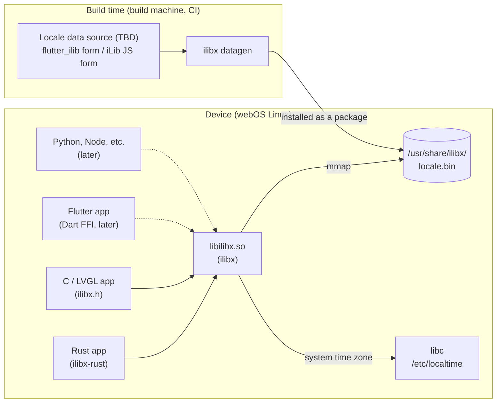
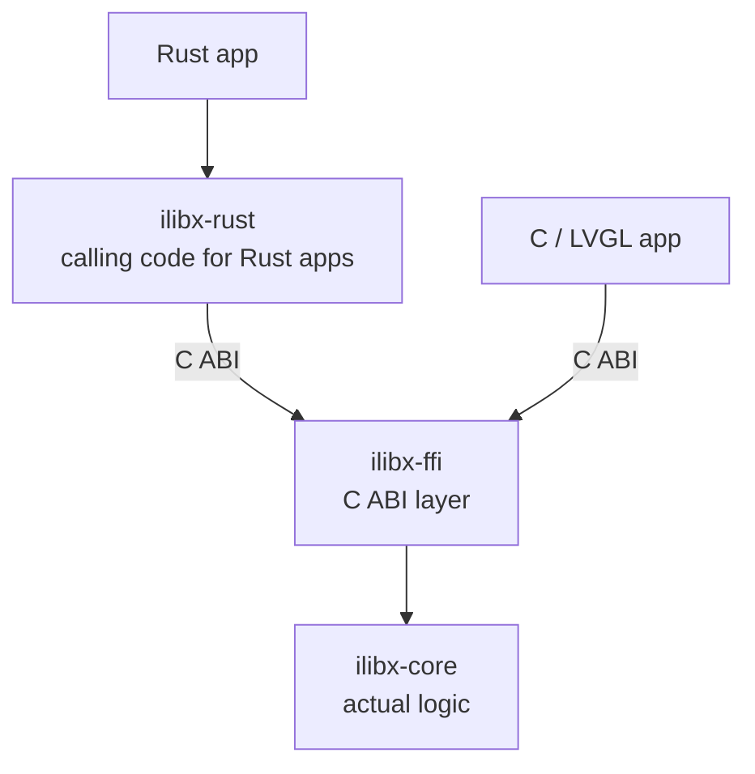
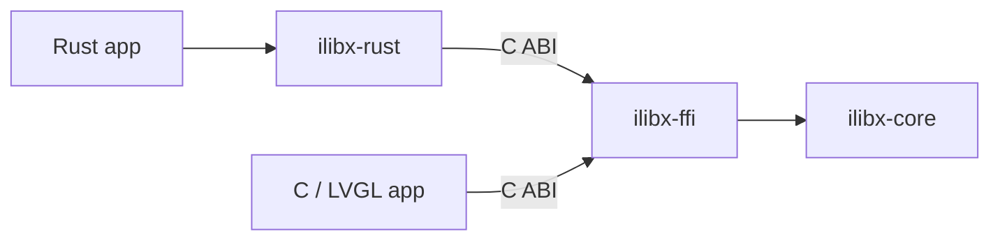

<!-- translated-from: docs/LLD_ilibx.ko.md blob 82feb5c8e186 -->
# (LLD) ilibx

> **Korean version**: [LLD_ilibx.ko.md](LLD_ilibx.ko.md). The Korean version is the authoring source, and this English version is translated from it. To change the content, edit the Korean version first.

| Date | Changes |
|---|---|
| 2026-11-25 | First draft. Filled the overview (§1–§4) and structure (§5) from earlier design documents. Measurements, verification and undecided items are TBD. Marked the source form of locale data (flutter_ilib / iLib JS) as undecided |
| 2026-11-25 | Emptied the parts not yet implemented (§5.1.2, §5.2.2–§5.2.8, the §5.4 usage example, §5.5) and left them as TBD, to be filled in during implementation |
| 2026-11-25 | Reduced §5 to the agreed concept (the existence of the three packages ilibx-core, ilibx-ffi and ilibx-rust, and how they call each other) and left the rest (including §5.1.3, §5.3 and §5.4) as TBD |

> **About this draft**: This document follows the same format as [LLD_flutter_ilib](https://github.com/iLib-js/flutter_ilib/blob/develop/doc/design/LLD_flutter_ilib.md). Because ilibx is not implemented yet, measurements, test links and some design items are left as **TBD**.
>
> **How locale data is handled is undecided (TBD, [§6 #17](#open-issues))**. It needs review and further investigation whether the source should be in the flutter_ilib form (one file per locale holding every kind of data) or in the iLib JS form (one file per kind of data under each locale directory). Descriptions of the data source, section selection, lookup rules and generation steps assume the flutter_ilib form, and are marked where they appear.

## 1. Document Descriptions

### 1.1 Purpose

ilibx is an i18n library for native apps (Rust, C/LVGL and others). It lets native apps get the same locale-specific results for dates, numbers, time zones and so on that iLib-family libraries (iLib JS, flutter_ilib) provide, to the same specification. It ports the logic of flutter_ilib v2.0 (pure Dart) to Rust, and all apps share one common library and one data file. It is structured so that custom data for a platform or product can be merged on top of the base locale data at build time.

This document describes the low-level design that the implementation, verification and review of ilibx all refer to.

### 1.2 Scope

Target: the first version of ilibx (planned as v0.1.0). The source form of locale data (flutter_ilib `assets/locale/` / iLib JS `js/data/locale/`) is TBD (§6 #17). Earlier analysis was based on flutter_ilib `assets/locale/` (2.0.0 `de16084`).

**In scope**

- Public interface: the C ABI (`libilibx.so`, `ilibx.h`) and the calling code for Rust apps (ilibx-rust)
- Core logic (ilibx-core): formatting, calendars, time zones, plurals, locale data lookup
- The format of the data file `locale.bin`, its generator (datagen) and its dump tool (ilibx-dump)
- Runtime behavior (mmap loading, locale chain lookup)
- Repository and package structure, build and distribution, test and CI structure

**Out of scope**

- The internal implementation of iLib JS and flutter_ilib (referenced only as the baseline for matching results)
- The internals of CLDR and ilib-assemble
- Individual apps that use ilibx, LVGL itself, the webOS platform and the Yocto build system
- Handling of translated strings (ResBundle). On webOS, libwebosi18n handles this

### 1.3 Document Structure

| Chapter | Title | Contents |
|---|---|---|
| 1 | Document Descriptions | Purpose, scope, structure, terms |
| 2 | Project Overview | Goals and resulting structure |
| 3 | Architectural Drivers | Constraints, functional requirements, quality attributes |
| 4 | System Context | System boundary and external entities |
| 5 | Architecture Design | Static (module), dynamic (C&C) and physical (deployment) perspectives, interface and data format |
| 6 | Open Issues | Items not yet decided |
| 7 | References | Reference documents |

Compared with the flutter_ilib LLD, this document adds §5.4 (interface specification), §5.5 (data format) and §6 (open issues), because for ilibx the C ABI is the contract with apps and ilibx defines its own data file format. The FMEA review and product-line considerations chapters of the flutter_ilib LLD are not included.

### 1.4 Terms and Definitions

| Term | Description |
|---|---|
| iLib | The JS i18n library of webOS. It has locale data processed from CLDR data and the formatting logic |
| flutter_ilib | An i18n package for Flutter that ports iLib to Dart. The baseline that ilibx results must match |
| CLDR | Unicode Common Locale Data Repository. The origin of iLib locale data |
| BCP-47 | The standard for locale tags (e.g. `ko-KR`, `zh-Hant-TW`) |
| C ABI | The C-style function calling convention. Almost every language can call other libraries this way, so it is used as the entry point of a shared library |
| crate / Cargo package | A unit of code that the Rust build tool (Cargo) builds at once |
| cdylib | The form of a Rust shared library exposed through the C ABI. `libilibx.so` takes this form |
| soname | The name of a shared library with its ABI version (`libilibx.so.1`) |
| `no_std` | A declaration that the code does not use the parts of the Rust standard library that need an OS (files, time, threads and so on) |
| alloc | Heap allocation (`String`, `Vec` and so on) that is available even under `no_std` |
| mmap | An OS feature that maps a file into the memory address space. Processes that map the same file share its physical pages |
| `locale.bin` | The binary data file converted from locale JSON at build time. One copy per device |
| document | The value tree in `locale.bin` that corresponds to one source JSON file (`root`, `ko`, `und-KR` and so on) |
| locale chain | The list of documents visited when looking up data for a locale (root → lang → … → lang-script-region) |
| value reference | A 32-bit integer in `locale.bin` that points to one value (low 3 bits for the kind + 29 bits for the value or position) |
| exclusion list | The list of data sections the generator leaves out of `locale.bin`. Optional; by default every section is included |
| PSS | Proportional Set Size. Memory usage where shared memory is divided by the number of processes sharing it |

## 2. Project Overview

ilibx aims to be a native i18n library that meets all of the following six goals.

1. Extensibility: easy to support new native platforms such as Rust and LVGL. Also consider OS-less MCUs
2. Custom data: custom data for a platform or product can be merged on top of the base locale data at build time
3. Sharing: one copy of the library and data per device, shared by all apps
4. Memory: low usage and safe management
5. Zero ICU dependency: no ICU4C, no ICU4X-family crates, no ICU bindings
6. Single version: all apps use the same version of the library and data

The structure that follows from these goals is **one shared `.so` + C ABI + one shared data file + data merged with custom data at build time**, and the implementation language is Rust (decided on 11-19).

## 3. Architectural Drivers

### 3.1 Constraints

#### 3.1.1 Business Constraints

**[Table 3-1]** Business constraints

| ID | Constraint | Description |
|---|---|---|
| BC01 | Open-source license (Apache-2.0) | The repository is distributed under the Apache License 2.0. Contributions and redistribution follow the license |
| BC02 | Same results as iLib and flutter_ilib | For the same locale and the same input, produce the same results as iLib and flutter_ilib. Matching takes priority over accuracy (e.g. daylight saving time for past dates must also match iLib). The baseline is the flutter_ilib test expectations (21,527 cases). The expectations are fixed regardless of the data source form (§6 #17); whichever form is chosen must pass them |
| BC03 | Supported locales | Support the same locales as flutter_ilib. 252 data files. The final locale list is TBD |
| BC04 | Upstream version alignment | Port the logic from flutter_ilib v2.0 (based on iLib JS v15.0.0 and CLDR 48.2). The data source (flutter_ilib `assets/locale/` / iLib JS `js/data/locale/`) is TBD (§6 #17). Logic and data are updated together |

\*BC: Business Constraint

#### 3.1.2 Technical Constraints

**[Table 3-2]** Technical constraints

| ID | Constraint | Description |
|---|---|---|
| TC01 | Implemented in Rust, zero ICU dependency | The main language is Rust. ICU4C, ICU4X-family crates (including general utilities such as zerovec and yoke) and ICU bindings are not used anywhere in the build, linking or data. Checked with cargo-deny and `readelf` |
| TC02 | Exposed through the C ABI | The only public interface is the C ABI. Rust apps also call the C ABI through ilibx-rust |
| TC03 | Shared library + one copy of shared data | One `libilibx.so` (cdylib) and one `/usr/share/ilibx/locale.bin` per device. Both are shipped in the same release and the same package |
| TC04 | Single version | Apps do not statically include the core logic. ilibx-rust does not depend on ilibx-core or ilibx-ffi |
| TC05 | Core is `no_std` + alloc | ilibx-core uses no OS features. It receives data only as `&[u8]`; files, mmap and time lookups are handled by the entry packages |
| TC06 | Minimum Rust version | Follow the rustc version of webOS Yocto. As of 2026-11-27, the rustc of webOS appears to be 1.75 (to be confirmed). The minimum supported version (`rust-version`) is therefore 1.75 and the edition is 2021 (edition 2024 needs rustc 1.85 or later). Features stabilized after 1.75 are not used, and CI builds with 1.75 to check this |
| TC07 | Target platform | webOS Linux (armv7). Development and testing on x86_64 Linux. MCUs are only considered as a possibility |
| TC08 | Minimal dependencies | Keep external crates to a minimum (libm and similar). Before adding one, check `no_std` support and zero ICU dependency first, and pin `Cargo.lock` |
| TC09 | No JSON parser on the device | JSON is read only by the generator on the build machine. The `.so` on the device reads only `locale.bin` |

\*TC: Technical Constraint

### 3.2 Functional Requirements

The FR IDs of the flutter_ilib LLD (FR1–FR13) are reused as they are, so the requirements of the two libraries can be compared one to one. Requirements that only ilibx has start at FR14. The native API scope is not decided yet (§6 #1), so the table below is a list of candidates.

**[Table 3-3]** Functional requirements

| Group | ID | Function | Description | Test scenario |
|---|---|---|---|---|
| Data loading | FR1-1 | Initial data loading | mmap `locale.bin` and check its header on the first API call. Synchronous, with no "ready" state (flutter_ilib loads asynchronously and then notifies) | TBD |
| | FR1-2 | Locale change | The library does not remember the current locale. When the locale changes, the app (or a platform-specific layer) creates new formatters | TBD |
| | FR1-3 | Default locale | Because the C ABI holds no state, how to handle the default locale is TBD (given on every call / read from the system locale) | TBD |
| | FR1-4 | Locale data lookup | Follow the locale chain and look up the most specific data first, giving the same result as the merge in iLib and flutter_ilib. The details depend on the data source form and are TBD (§5.2.5, §6 #17) | TBD |
| | FR1-5 | Releasing locale data | Not applicable. The mapping is kept until the process ends and is never released | — |
| Locale | FR2-1 | BCP-47 parsing | Parse, normalize and validate locale tags | TBD |
| | FR2-2 | Available locales | Return the list of locales in `locale.bin` | TBD |
| Locale info | FR3-1 | Locale metadata | Return locale conventions such as clock, calendar, time zone, currency, separators and digits | TBD |
| Date format | FR4-1 | Date and time formatting | Turn a point in time into a string using locale patterns and options | TBD |
| | FR4-2 | Calendar-specific formatting | Convert the date to the formatter's calendar before formatting (e.g. the Persian calendar for fa-IR) | TBD |
| | FR4-3 | Localized names and digits | Use month, weekday, era and AM/PM names and native digits | TBD |
| | FR4-4 | Format metadata | Return the pattern, clock, calendar, component order and so on | TBD |
| Calendar | FR5-1 | Calendar rules | Number of months, month lengths and leap-year rules for the calendars flutter_ilib supports | TBD |
| | FR5-2 | Conversion between calendars | Convert dates between calendars through Rata Die / Julian Day | TBD |
| | FR5-3 | Unsupported calendars | Report with an error code (corresponds to `UnimplementedError`·`ArgumentError` in flutter_ilib) | TBD |
| Time zone | FR6-1 | Offset and daylight saving time | Compute offsets, daylight saving time and display names from iLib zoneinfo data. Not delegated to ICU | TBD |
| | FR6-2 | System time zone | ilibx-ffi reads `local` through libc (`localtime_r`) or `/etc/localtime` | TBD |
| | FR6-3 | Time zone list | Return the list of time zone IDs (optionally by country) | TBD |
| Number format | FR7-1 | Number formatting | Format numbers with options such as separators, grouping, digits and rounding | TBD |
| | FR7-2 | Percent formatting | Use the locale percent pattern | TBD |
| | FR7-3 | Currency formatting | Use the currency symbol or code and the number of decimal places. An error if the currency code is missing or unknown | TBD |
| Currency | FR8-1 | Currency metadata | Code, name, symbol, number of decimal places | TBD |
| Duration format | FR9-1 | Duration formatting (text) | Format durations with the locale plural rules | TBD |
| | FR9-2 | Duration formatting (clock) | The hh:mm:ss form | TBD |
| | FR9-3 | RTL output | Add U+200F for RTL locales | TBD |
| Country | FR10-1 | Country lookup | Country code ↔ localized name, and the list | TBD |
| Script | FR11-1 | Script metadata | ISO 15924 code, number, name, direction, whether an IME is needed, whether it has letter case | TBD |
| Case | FR12-1 | Case conversion | Language-specific exceptions (Turkish i, German ß, Greek final sigma) come from iLib data; the rest is handled by Rust `core` (§6 #8) | TBD |
| Version | FR13-1 | Version information | Return the library version and the source information in the `locale.bin` header (flutter_ilib commit, CLDR version, generator version) | TBD |
| C ABI | FR14-1 | Formatter lifetime | Formatters are handled through three functions: create, use and free | TBD |
| | FR14-2 | Returning results | Results are written as UTF-8 into a buffer supplied by the caller. Behavior when the buffer is too small is TBD | TBD |
| | FR14-3 | Reporting errors | Errors are reported as numeric codes. A panic never crosses the C ABI boundary | TBD |
| Rust apps | FR15-1 | ilibx-rust | Rust apps use ilibx without handling pointers, buffers or freeing (`DateFmt::new`, `format`, freed in `Drop`) | TBD |
| Data tools | FR16-1 | Data generation | Convert every section of the locale JSON into `locale.bin` and report the size of each section. Sections in the exclusion list, if given, are left out | TBD |
| | FR16-2 | Data dump | Print the header, chains and values by path of `locale.bin` (`ilibx-dump`) | TBD |

### 3.3 Quality Attributes

The target value of each quality attribute, and the criteria for setting it, are not decided yet (TBD, §6 #15). The "reference" values in the table are given for comparison only and are not targets.

**[Table 3-4]** Quality attributes

| ID | Attribute | Scenario | Test case | Difficulty | Importance |
|---|---|---|---|---|---|
| QA01 | Memory (sharing effect) | With one and two apps of the same function running, the increase in total PSS is smaller than with the JSON approach. Target TBD | TC-QA01 | TBD | TBD |
| QA02 | Performance (first call) | Time until the first API call completes (mapping + header check). Target TBD | TC-QA02 | TBD | TBD |
| QA03 | Performance (date formatting) | Average time of `format()` on a reused formatter. Target TBD (reference: flutter_ilib v2.0 O26 309 µs/op) | TC-QA03 | TBD | TBD |
| QA04 | Size | Size of `libilibx.so` and `locale.bin`. Target TBD (measured after a real `locale.bin` is built) | TC-QA04 | TBD | TBD |
| QA05 | Safety | `unsafe` appears only at the C ABI boundary and in the mmap loader. Invalid data or input returns an error code without a panic | TC-QA05 | TBD | TBD |

#### 3.3.1 Benchmark Test Cases

TBD.

## 4. System Context

ilibx spans two areas: build time and device runtime. At build time it turns the locale data source (form TBD, §6 #17) into `locale.bin`; on the device, apps in several languages call the same `libilibx.so` through the C ABI.

**[Figure 4-1]** System context diagram

> **Notation**: Solid lines are relationships in the first version; dotted lines are relationships that may come later.

**[Table 4-1]** Entities

| Entity | Responsibility |
|---|---|
| ilibx (`libilibx.so`) | The subject of this document. Provides locale-specific formatting and information for dates, numbers, time zones and so on through the C ABI |
| `locale.bin` | Locale data built at build time. Read-only, one copy per device |
| Locale data source | Locale JSON. Either flutter_ilib `assets/locale/` (one file per locale) or iLib JS `js/data/locale/` (one file per kind of data under each locale directory); TBD |
| datagen | The generator that turns JSON into `locale.bin`. Runs only on the build machine |
| Rust app | A webOS native app that uses ilibx through ilibx-rust |
| C / LVGL app | An app that calls the C functions directly using `ilibx.h` |
| Flutter app, apps in other languages | Apps that may later use ilibx through language-specific calling code |
| libc | Provides the system time zone (`localtime_r`, `/etc/localtime`) |

**[Table 4-2]** Relationships

| Relationship | Responsibility |
|---|---|
| App → `libilibx.so` | C ABI function calls. Dynamic linking within the same process, with no IPC |
| `libilibx.so` → `locale.bin` | Read-only mmap. Multiple processes share the page cache |
| `libilibx.so` → libc | System time zone lookup |
| Data source → datagen → `locale.bin` | Data selection, deduplication and encoding at build time. Data is never updated separately on the device |

## 5. Architecture Design

### 5.1 Static Perspectives

#### 5.1.1 First-Level Decomposition

> **Status**: What is decided so far is only the concept that there are three packages (ilibx-core, ilibx-ffi, ilibx-rust). Package details (crate-type, dependency rules, tools and test layout) are TBD.

**[Figure 5-1]** First-level decomposition (package concept)

**[Table 5-1]** Responsibilities of first-level elements

| Element | Responsibility |
|---|---|
| ilibx-core | The actual logic (locale-specific logic for formatting, calendars, time zones and so on) |
| ilibx-ffi | The C ABI layer. The entry point every app calls, and the library shared on the device |
| ilibx-rust | Calling code that lets Rust apps use ilibx without handling the C ABI directly |

*Related figure: [Figure 5-1]* · Perspective: static

#### 5.1.2 Second-Level Decomposition (inside ilibx-core)

TBD. Left empty because it is not implemented yet. To be filled in during implementation.

#### 5.1.3 Repository Structure

TBD. Nothing is decided beyond keeping the three packages in one repository.

### 5.2 Dynamic Perspectives

#### 5.2.1 Runtime Components

**[Figure 5-2]** Call flow (concept)

**[Table 5-2]** Connection responsibilities

| Connection | Responsibility |
|---|---|
| Rust app → ilibx-rust → ilibx-ffi | Rust apps call the C ABI through ilibx-rust |
| C / LVGL app → ilibx-ffi | C apps call the C ABI directly |
| ilibx-ffi → ilibx-core | Passes requests received through the C ABI to the core logic |

*Related figure: [Figure 5-2]* · Perspective: dynamic

Detailed behavior such as data loading, value conversion, error handling and thread safety is TBD.

#### 5.2.2 Initialization Sequence

TBD. Left empty because it is not implemented yet. To be filled in during implementation.

#### 5.2.3 Locale Change Sequence

TBD. Left empty because it is not implemented yet. To be filled in during implementation.

#### 5.2.4 Date Formatting Sequence

TBD. Left empty because it is not implemented yet. The sequence diagram and step table will be filled in during implementation.

#### 5.2.5 Locale Data Lookup

TBD. Left empty because it is not implemented yet and the way locale data is handled (§6 #17) is not decided.

#### 5.2.6 Number and Duration Formatting

TBD. Left empty because it is not implemented yet. The sequence diagram and step table will be filled in during implementation.

#### 5.2.7 Mapping State

TBD. Left empty because it is not implemented yet. To be filled in during implementation.

#### 5.2.8 Data Generation Pipeline (Build Time)

TBD. Left empty because it is not implemented yet. To be filled in during implementation.

### 5.3 Physical Perspectives

TBD. Left empty because it is not implemented yet. Only the direction is decided: one copy of the library and data per device, shared by all apps. Distribution and packaging details are not decided.

### 5.4 Interface Specification (C ABI)

TBD. Left empty because it is not implemented yet. The C function design principles considered so far are: create, use and free; UTF-8; caller-supplied buffers; numeric error codes; no callbacks.

### 5.5 Data Format (`locale.bin`)

TBD. Left empty because it is not implemented yet. To be filled in during implementation.

## 6. Open Issues

| # | Issue | Related sections |
|---|---|---|
| 1 | Decide the native API scope (FR list) | §3.2 |
| 2 | Implementation language of the generator (Rust / Python) | §5.2.8 |
| 3 | When to generate (at build time / at release time) | §5.2.8 |
| 4 | Width of key numbers (u16 / u32) | §5.5 |
| 5 | Whether to check CRC32 when mapping | §5.2.2 |
| 6 | Handling when `locale.bin` is missing or corrupted | §5.2.2, §5.2.7 |
| 7 | Decide which sections to exclude (features left out of the native API scope, MCU profile) | FR16-1, §6 #1, §6 #18 |
| 8 | Whether to leave basic case conversion to Rust `core` or build a table from iLib data | FR12-1 |
| 9 | Whether libm trigonometric results match Dart | FR4-2 |
| 10 | How to handle the default locale | FR1-3 |
| 11 | Scope of thread-safety guarantees for handles (`Send`/`Sync`) | §5.2.1 |
| 12 | List of C functions, error codes, handling of small buffers | §5.4 |
| 13 | Whether to have a global chain cache | §5.2.4 (TBD) |
| 14 | Confirm the rustc version of webOS Yocto (appears to be 1.75 as of 2026-11-27). Once confirmed, finalize 1.75 and edition 2021 in TC06 | TC06 |
| 15 | Quality attribute targets, the criteria for setting them, and the benchmark procedure | §3.3 |
| 16 | How to bring the data source and expectations into the repository | §5.1.3 |
| 17 | **How to handle locale data: the flutter_ilib form (one file per locale holding every kind of data) / the iLib JS form (one file per kind of data under each locale directory).** Needs review and further investigation. Criterion: pass the flutter_ilib expectations (BC02). If the iLib JS form is chosen, use data from the same iLib version as flutter_ilib v2.0 (v15.0.0) | §1.2, BC02, BC04, FR1-4, §4, §5.1.2, §5.2.5, §5.2.8, §5.5 |
| 18 | Feature scope to provide on MCUs | §2 |
| 19 | PoC of the Rust sharing setup: check NEEDED, symbols and mappings with cdylib + ilibx-rust + two apps | §5.3, TC03 |
| 20 | Check for name clashes of ilibx (npm, crates.io, internal repositories) and of the C symbol prefix `ilibx_` | §5.4 |

## 7. References

| Resource | Link |
|---|---|
| flutter_ilib | https://github.com/iLib-js/flutter_ilib |
| LLD flutter_ilib | https://github.com/iLib-js/flutter_ilib/blob/develop/doc/design/LLD_flutter_ilib.md |
| iLib | https://github.com/iLib-js/iLib |
| CLDR | https://cldr.unicode.org/ |
